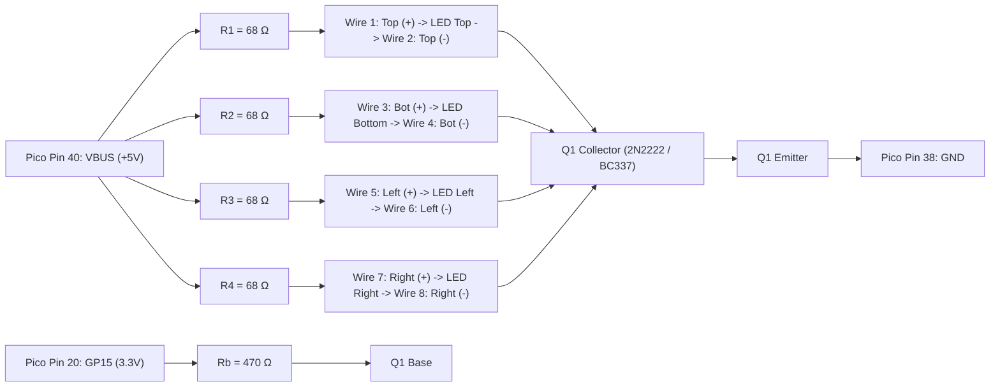

# IR LED Diamond Wiring & Power Control Schematic (8-Wire Star Topology)

This document describes the hardware driver circuit for the **4 infrared LEDs (920 nm – 940 nm)** arranged in a diamond around the TV, wired in a **star topology with 8 wires (2 per LED)** coming directly from the system board, powered from the **Raspberry Pi Pico 2 W** (or Pico W) `VBUS` pin and automatically switched on/off via `GP15`.

---

## 1. Raspberry Pi Pico 2 W Pinout

| Physical Pin | Pico Signal | Role in Project |
|---|---|---|
| **Pin 40** | `VBUS` (+5 V USB) | Supply rail feeding the 4 parallel LED current-limiting resistors |
| **Pin 38** | `GND` | Common ground and transistor emitter / source return |
| **Pin 20** | `GP15` (3.3 V logic) | Transistor gate/base control (`HIGH` = Wiimote connected) |
| **Pin 1 / Pin 2** | `GP0` (TX) / `GP1` (RX) | *(Optional)* 115200 baud UART debug console |

---

## 2. Circuit Schematic (4 Parallel Branches, 8 Wires from Board)

Each IR LED has its own 2-wire cable (`+` Anode and `-` Cathode = **8 wires total** leaving the board's terminal block/header) without any series daisy-chaining around the TV bezel:

```text
   Raspberry Pi Pico 2 W                  System Board               TV Frame (8 wires total)
  +---------------------+
  |                     |
  |  Pin 40 (VBUS 5V) o-+----+--------+--------+--------+
  |                     |    |        |        |        |
  |                     |  [R1]     [R2]     [R3]     [R4]   (4x 68 Ω or 100 Ω, 1/4 W)
  |                     |    |        |        |        |
  |                     |  (TOP+)  (BOT+)  (LEFT+) (RIGHT+)  --- 4 Anode wires out
  |                     |    |        |        |        |
  |                     |   \ /      \ /      \ /      \ /   4x IR LEDs (920-940 nm)
  |                     |   ---      ---      ---      ---   mounted on TV bezel
  |                     |    |        |        |        |
  |                     |  (TOP-)  (BOT-)  (LEFT-) (RIGHT-)  --- 4 Cathode wires back
  |                     |    |        |        |        |
  |                     |    +--------+--------+--------+
  |                     |                      |
  |                     |                      |  Collector (C) / Drain (D)
  |                     |                    |/
  |  Pin 20 (GP15)    o-+---[ Rb = 470 Ω ]---|  Q1: NPN (2N2222 / BC337)
  |                     |                    |\     or N-MOSFET (AO3400 / 2N7000)
  |                     |                      v  Emitter (E) / Source (S)
  |                     |                      |
  |  Pin 38 (GND)     o-+----------------------+
  +---------------------+                      |
                                              GND
```



---

## 3. Resistor & Current Calculations

Standard **920 nm – 940 nm** IR LEDs (such as Vishay TSAL6200, TSAL6400, or generic 5 mm IR emitters) have a typical forward voltage of:

```math
V_F \approx 1.35\text{ V} - 1.45\text{ V}\quad (\text{using } V_F = 1.4\text{ V})
```

With **1 LED per branch** powered from `VBUS = 5.0 V` and an NPN saturation drop $V_{CE,\text{sat}} \approx 0.2\text{ V}$:

```math
V_{\text{resistor}} = 5.0\text{ V} - 1.4\text{ V} - 0.2\text{ V} = 3.4\text{ V}
```

### Choosing $R_1 \dots R_4$ (one per LED)

| Resistance $R_1 \dots R_4$ | Current per LED ($I_{\text{LED}}$) | Total USB current ($4 \times I_{\text{LED}}$) | Power per resistor | Notes |
|---|---|---|---|---|
| **68 Ω** (1/4 W or 1/2 W) | $\approx 50.0\text{ mA}$ | $\approx 200\text{ mA}$ | $0.170\text{ W}$ | **Recommended** (high brightness at 2.5 m – 4 m) |
| **82 Ω** (1/4 W) | $\approx 41.5\text{ mA}$ | $\approx 166\text{ mA}$ | $0.141\text{ W}$ | Balanced brightness and lower heat |
| **100 Ω** (1/4 W) | $\approx 34.0\text{ mA}$ | $\approx 136\text{ mA}$ | $0.116\text{ W}$ | Standard 1/4 W resistors, low power draw |

> [!TIP]
> If you use a **logic-level N-channel MOSFET** (e.g. `AO3400` or `BSS138`), its $V_{DS} \approx 0\text{ V}$ leaves $3.6\text{ V}$ across each resistor (~53 mA per LED with `68 Ω` or ~36 mA per LED with `100 Ω`). Avoid `2N7000` at 200 mA total due to its higher $R_{DS(\text{on})}$; use `AO3400`, `2N2222A`, or `BC337`.

### Base Resistor ($R_B$) for NPN (`2N2222` / `BC337`)

With `GP15` HIGH ($V_{\text{GPIO}} = 3.3\text{ V}$) and $V_{BE,\text{sat}} \approx 0.7\text{ V}$:

```math
I_B = \frac{3.3\text{ V} - 0.7\text{ V}}{470\text{ }\Omega} = 5.5\text{ mA}
```

- **GPIO safety:** `5.5 mA` is safely below the RP2350/RP2040 nominal per-pin limit (`12 mA`).
- **Hard saturation:** For $I_C = 200\text{ mA}$, forced gain is $\beta_{\text{forced}} = \frac{200}{5.5} \approx 36$, ensuring clean saturation in a `2N2222A` or `BC337-25/40`. For a MOSFET, `Rb = 470 Ω` (optionally with a `10 kΩ` pull-down to `GND`) also protects the GPIO pin.

---

## 4. Automatic Power Saving

The firmware keeps `GP15 = 0` (`LOW`) whenever no Wiimote is connected:
- **Idle (no controller connected):** $I_{\text{LEDs}} = 0\text{ mA}$. All 4 IR LEDs remain off.
- **Connected:** `wiimote_bt.c` calls `ir_leds_set_enabled(true)` as soon as the L2CAP Interrupt channel (`PSM 0x0013`) opens, turning on the 4 IR LEDs and the Pico's onboard LED.
- **Disconnected:** When the L2CAP link closes, `ir_leds_set_enabled(false)` pulls `GP15` low immediately.

---

## 5. Physical Mounting Layout Around the TV

Route each of the 4 independent 2-wire pairs from the board's 8-pin connector directly to the midpoint of each bezel edge, pointing straight toward the viewer:

```text
                  (Top: 50%, 0%)
                    * LED Top  <=== 2 wires (TOP+, TOP-)
                  /           \
                 /             \
(Left: 0%, 50%) *   TV Screen   * (Right: 100%, 50%)
   ^ 2 wires     \             /     ^ 2 wires
  (LEFT+, LEFT-)  \           /     (RIGHT+, RIGHT-)
                   * LED Bottom
                (Bottom: 50%, 100%)
                   ^ 2 wires (BOT+, BOT-)
```

- **Field of view:** On a 32" TV ($\approx 71\text{ cm} \times 40\text{ cm}$) at $2.5\text{ m}$, the diamond spans roughly $16^\circ \times 9^\circ$ inside the Wiimote PixArt camera's $\approx 33^\circ \times 23^\circ$ FOV, keeping all 4 LEDs visible across virtually the entire screen. On larger TVs (55"+) or closer seating distances, the `4 -> 3 -> 2` fallback seamlessly tracks edges and corners.
